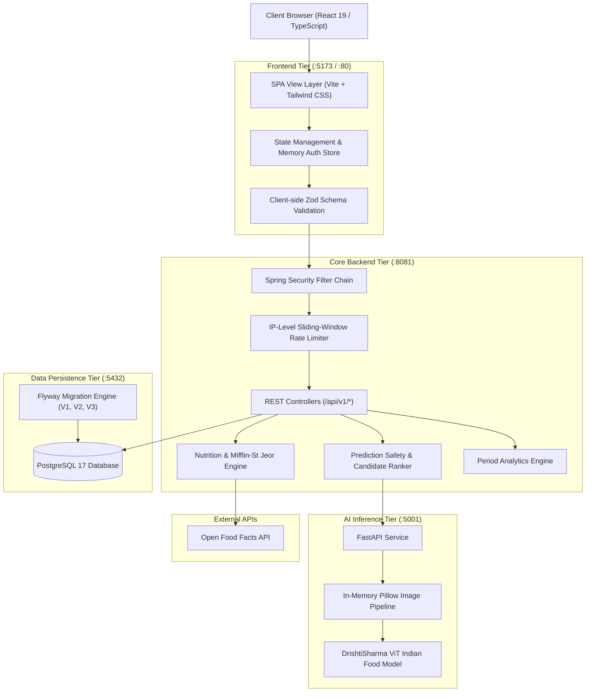
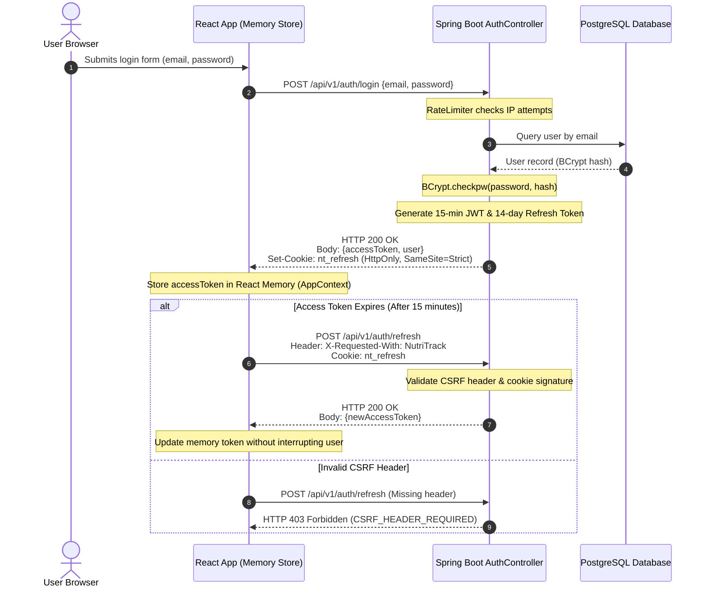
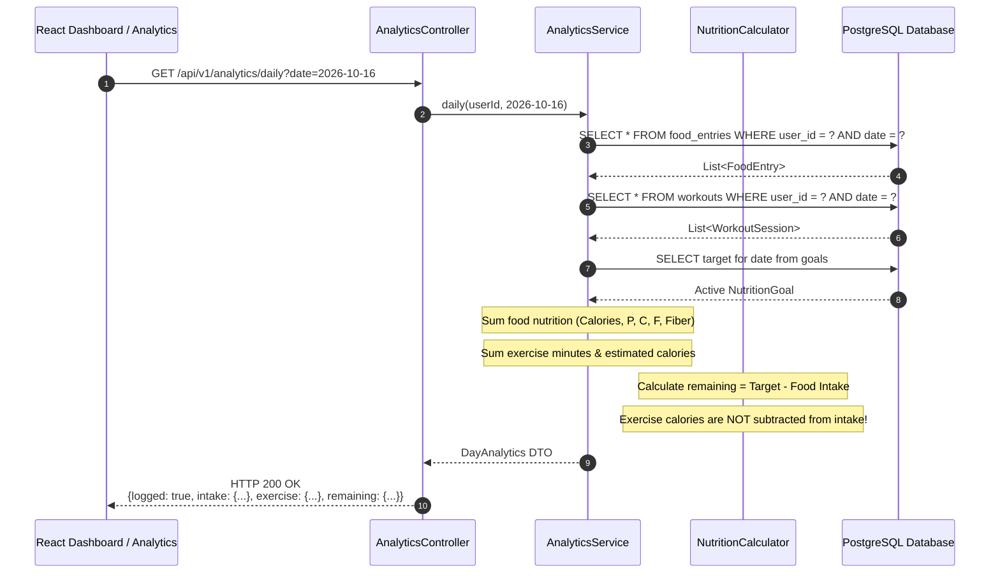

# NutriTrack AI — System Architecture & Design Specification

**Document Version:** 1.0.0  
**Target Release:** Stage 20 Portfolio Release  
**System Status:** Fully Integrated & Verified  

---

## 1. System Overview & Component Responsibilities

NutriTrack AI is architected as a decoupled, multi-tiered microservices platform designed for high nutritional accuracy, low inference latency, and uncompromising user data privacy.



### Component Responsibilities Matrix

| Tier | Technology | Primary Responsibilities | Privacy & Security Guarantees |
|---|---|---|---|
| **Frontend** | React 19, TypeScript, Vite | User interface, responsive layout, form validation, client-side optimistic updates, accessible charting | Zero token persistence in `localStorage`/`sessionStorage`; in-flight double-submit guards |
| **Core Backend** | Java 17, Spring Boot 3.5.6 | Authentication, session lifecycle, authorization checks, catalog search, nutrition scaling, analytics aggregation | Sliding-window rate limiting; multi-tenant IDOR defense; zero image disk writes |
| **AI Inference** | Python 3.11, PyTorch, Transformers | Vision Transformer food classification, logits generation, fallback heuristic management | Images received as byte buffers in RAM; discarded immediately after forward pass |
| **Data Tier** | PostgreSQL 17, Flyway | Persistent relational data, foreign key cascade constraints, composite indexing for time-series queries | Strict database isolation; version-controlled schema migrations |
| **External Tier** | Open Food Facts REST API | Secondary fallback for uncataloged packaged foods | Read-only lookup; external results tagged with `BRANDED_PRODUCT` source attribution |

---

## 2. Authentication & Refresh Token Architecture

NutriTrack AI implements an industry-standard short-lived access token + HttpOnly refresh cookie session model.



### Key Security Invariants:
1. **Memory-Only Access Tokens:** Even if a malicious script executes, it cannot access tokens from `localStorage` because none exist there.
2. **SameSite=Strict & Path Scoped:** The `nt_refresh` cookie is scoped specifically to `/api/v1/auth` and marked `SameSite=Strict`, preventing cross-site transmission.
3. **CSRF Header Enforcement:** All state-changing session requests require `X-Requested-With: NutriTrack`. Cross-origin browsers cannot send custom headers without passing a CORS preflight options check.

---

## 3. AI Food-Image Inference & Prediction Safety Flow

The food image scanning pipeline incorporates a six-state prediction safety policy to prevent closed-set AI hallucinations and ensure explicit user review.

```mermaid
sequenceDiagram
    autonumber
    actor User as User
    participant App as Frontend Scanner
    participant Back as Spring Boot Backend
    participant ML as Python ViT Microservice
    participant DB as PostgreSQL Catalog

    User->>App: Selects food photo
    App->>Back: POST /api/v1/scanner/analyze (Multipart image buffer)
    Note over Back: Enforce 10MB limit (stored in RAM only)
    Back->>ML: POST /classify (Stream bytes)
    Note over ML: Pillow loads in RAM -> ViT model inference
    ML-->>Back: JSON: {predictions: [{label: "samosa", score: 0.94}, ...]}
    
    Note over Back: Apply Six-State Prediction Safety Policy
    Back->>DB: Query verified catalog by canonical name & aliases
    DB-->>Back: Matching catalog candidates with 100g baselines
    Note over Back: Rank candidates deterministically
    Back-->>App: HTTP 200 OK<br/>{items: [{name: "Samosa", confidence: "high", candidates: [...]}]}
    
    Note over App: Render Review Modal with Nutrition Breakdown
    alt User Adjusts Quantity & Confirms
        User->>App: Sets quantity to 2 pieces -> Clicks "Confirm & save"
        App->>Back: POST /api/v1/food-entries {name, meal, quantity, nutrition}
        Back->>DB: INSERT into food_entries
        DB-->>Back: Entry created (UUID)
        Back-->>App: HTTP 201 Created
        Note over App: Diary reflects confirmed meal
    else User Cancels Review
        User->>App: Clicks "Discard" or navigates away
        Note over App: Zero database calls made; diary untouched
    end
```

### The Six-State Prediction Safety Policy

1. **`SUPPORTED_ACCEPTABLE`:** ViT confidence $\ge 0.50$ and top prediction matches a verified catalog item. Displayed with high confidence.
2. **`SUPPORTED_UNCERTAIN`:** ViT confidence between $0.25$ and $0.50$. Displayed with a warning badge and suggestions to review portion weight.
3. **`UNSUPPORTED_OOD`:** Image features do not correlate with any of the 20 Indian food classes. Flagged as out-of-distribution; user prompted to search verified catalog.
4. **`AMBIGUOUS_MIXED_DISH`:** Visual conflations (e.g., Chicken Biryani vs Fried Rice) are caught by disambiguation rules that surface ranked catalog alternatives.
5. **`DEGRADED_FALLBACK`:** If the PyTorch sidecar is unreachable or running in resource-constrained environments, heuristic estimation kicks in with clear user disclosure.
6. **`NO_VALID_PREDICTION`:** Zero-byte files, non-image MIME types, or corrupted buffers are rejected before reaching model weights.

---

## 4. Nutrition Calculation & Analytics Aggregation Flow



### Analytics Period Aggregation Rules:
- **Logged Days vs Calendar Days:** Period averages divide total consumed nutrients strictly by `loggedDays` ($\sum \text{Calories} / \text{loggedDays}$). Unrecorded days do not depress the average.
- **Empty Period Representation:** If a user views a month with 0 logged days, `loggedDays` is reported as `0` and average intake is `null`, rather than displaying false `0 kcal/day` progress.
- **Workout Decoupling:** Exercise energy is tracked in an independent `ExerciseTotals` object. The daily nutritional calorie balance remains `Remaining = Target - Food Intake`.

---

## 5. Security Boundaries & Multi-Tenant Isolation

```
                   ┌──────────────────────────────────────┐
                   │           Public Internet            │
                   └──────────────────┬───────────────────┘
                                      │
                         HTTPS / TLS (Port 443 / 8081)
                                      │
                   ┌──────────────────▼───────────────────┐
                   │    Spring Security Boundary          │
                   │  • JwtAuthenticationFilter           │
                   │  • RateLimiter (10 req/15m on login) │
                   │  • CsrfProtectionFilter              │
                   └──────────────────┬───────────────────┘
                                      │ Authenticated Principal
                   ┌──────────────────▼───────────────────┐
                   │     Multi-Tenant Ownership Layer     │
                   │  • All queries filtered by user_id   │
                   │  • Foreign IDOR access -> 404        │
                   │  • Cascade deletion on account purge │
                   └──────────────────┬───────────────────┘
                                      │
                   ┌──────────────────▼───────────────────┐
                   │       PostgreSQL Data Isolation      │
                   │  • user_id FK on all child entities  │
                   │  • Composite index (user_id, date)   │
                   └──────────────────────────────────────┘
```

All SQL queries and JPA repository lookups require the authenticated `user_id` as part of the query predicate:
```java
// Example multi-tenant lookup in FoodEntryRepository
Optional<FoodEntry> findByIdAndUserId(UUID id, UUID userId);
```
Attempts by an authenticated user to access a foreign resource ID return `404 NOT_FOUND` rather than `403 FORBIDDEN`, ensuring zero disclosure of object existence across tenants.
